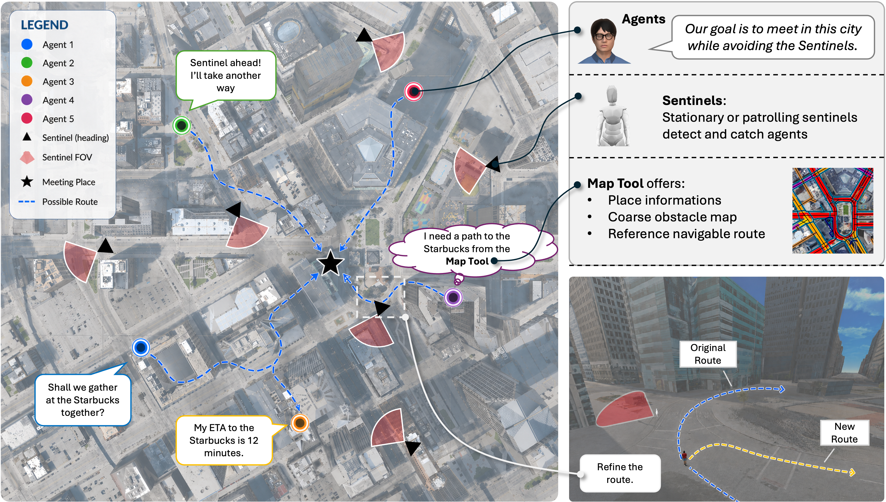

# Sentinel: Embodied Cooperative Spatial Reasoning and Planning



This repo contains code for the following paper:

_Xiangye Lin\*, Hongxin Zhang\*, Ruxi Deng, Qinhong Zhou, Chuang Gan_: Sentinel: Embodied Cooperative Spatial Reasoning and Planning

Paper: [https://arxiv.org/pdf/2605.26239](https://arxiv.org/pdf/2605.26239)

Project website: [site source](docs/index.html) (open `docs/index.html` locally to preview).

We introduce the **Sentinel Challenge**, a benchmark for studying _Cooperative Spatial Intelligence_, in which multiple decentralized embodied agents must communicate in natural language to agree on a mutually safe and convenient meeting point in city-scale outdoor environments, then navigate there while avoiding dynamic sentinels patrolling the scene with only a coarse map tool for spatial guidance. To address this problem, we propose **CoSaR**, a cooperative spatial reasoning and planning framework that bridges the communication and planning strengths of foundation models with classical spatial navigation algorithms. CoSaR maintains a dynamic spatial memory of poses, ETAs, occupancy, and sentinel danger zones, and uses a spatial-aware reasoning module to decide when to communicate, query the map tool, navigate, or wait. Across 14 city-scale scenes with 3–5 agents, CoSaR consistently achieves faster gathering, shorter path lengths, and improved safety over strong baselines.


## Installation

The Sentinel Challenge is built on top of [Virtual Community](https://github.com/UMass-Embodied-AGI/Virtual-Community). The simulator runs on Python 3.11, CUDA 11.7, Ubuntu 24.04. Install [uv](https://docs.astral.sh/uv/getting-started/installation/), then run the one-shot setup from the repository root:

```bash
bash setup.sh
```

This fetches the submodules, builds the Virtual Community environment with `uv` (installing Genesis at its pinned commit), and layers the release-only dependencies — vLLM and the scene-graph perception backbones — in the order required to avoid known build conflicts. See `setup.sh` for the individual steps if you need to run them manually.

Activate the environment in every new shell:

```bash
source Virtual-Community/.venv/bin/activate
```

### Assets

Virtual Community assets are hosted on HuggingFace at [Virtual-Community-AI/assets](https://huggingface.co/datasets/Virtual-Community-AI/assets) and are **downloaded automatically** the first time you run a scene. The DETROIT scene used by this release is published there, so no manual setup is required.

To pre-fetch all assets in advance:

```bash
python -c "from vico.tools.asset_utils import download_all_assets; download_all_assets()"
```

For indoor scenes from GRUtopia, follow [their instructions](https://github.com/OpenRobotLab/GRUtopia?tab=readme-ov-file#%EF%B8%8F-assets) to download `commercial_scenes.zip` and unzip it under `Virtual-Community/vico/assets/ViCo/scene/`. Otherwise pass `--no_load_indoor_scene` to the runners.

### System Requirements

- **RAM**: 24 GB minimum / 32 GB recommended
- **VRAM**: 10 GB minimum / 16 GB recommended
- **Disk**: 60 GB minimum / 100 GB recommended


## Run Experiments

The main implementation of _CoSaR_ is in `agents/sentinel_challenge/CoSaR.py` (agent), `agents/sentinel_challenge/base_nav.py` (shared navigation base), and `agents/sentinel_challenge/meeting_prompts/cosar_prompts/` (LLM prompts). The challenge entry point is `sentinel_challenge/challenge.py`.

Runners live under `sentinel_challenge/`:

| Folder | Perception |
|---|---|
| `sentinel_challenge/gt_scripts/` | Ground-truth segmentation for all agents (`--enable_gt_segmentation`) |
| `sentinel_challenge/no_gt_scripts/` | Ground-truth segmentation restricted to sentinels (`--gt_only_for_sentinels`); other agents use learned perception |

Each folder contains one script per method (`cosar` = our method, plus baselines `mcts`, `roco`, `coela`, `center`, `center_no_avoidance`, `fixed`, `rl`, `mat`, and CoSaR ablations `_no_analyzer`, `_no_emergency_avoidance`, `_no_refine`, `_no_spatial_memory`, `_qwen`).

For example, to run CoSaR with 3 agents and 1 stationary sentinel in DETROIT under the oracle-perception setting:

```bash
bash sentinel_challenge/gt_scripts/run_cosar.sh DETROIT 3 stationary 1 0
```

Same configuration without oracle perception:

```bash
bash sentinel_challenge/no_gt_scripts/run_cosar.sh DETROIT 3 stationary 1 0
```


## Responsible Use and Ethical Considerations

Sentinel is intended to support research on cooperative embodied intelligence in safety-relevant scenarios, including search-and-rescue, disaster response, and autonomous logistics. It provides a standardized, controlled environment for studying multi-agent planning, communication, and reasoning under partial observability and dynamic risk.

The benchmark is entirely simulation-based and contains only synthetic agents and environments. It does not use or release real-world human data, biometric information, or personally identifiable information. Accordingly, the primary ethical concern is not the benchmark data itself, but the possible transfer of cooperative navigation and reasoning methods to harmful real-world applications.

These capabilities are inherently dual-use. In particular, the following applications are outside the intended scope of this project:

- Mass surveillance
- Biometric identification
- Predictive policing
- Tracking or monitoring identifiable individuals without appropriate authorization

We ask users to apply Sentinel only for lawful, authorized, and ethically reviewed purposes, with safeguards appropriate to their deployment context. Concerns about misuse, documentation, or other responsible-use issues can be reported through the repository's [issue tracker](https://github.com/UMass-Embodied-AGI/Sentinel/issues). We will maintain this guidance through versioned updates as the benchmark and its uses evolve.


The standard runners share their launch settings in `sentinel_challenge/run_experiment.sh`. Existing script names and positional arguments are preserved. Invoke them from any directory using an absolute script path; relative checkpoint and output paths are resolved from the repository root, and existing `PYTHONPATH` entries are preserved. RL and MAT accept an optional sixth positional argument for a checkpoint. The Qwen runners retain their separate server lifecycle.

Check runner arguments and shell syntax without launching the simulator:

```bash
python -m unittest discover -s tests -p 'test_experiment_runners.py'
```


## Generate a Replay Video

Replay rendering uses saved episode records and camera images; it requires CPU resources, not a GPU. On Unity, run rendering inside a Slurm allocation. From the activated environment:

```bash
python tools/make_video_demo.py \
  --data_dir /path/to/AUSTIN/sentinel_gt_5/patrol_5/job_1 \
  --scene AUSTIN \
  --scene_assets_dir /path/to/private/scenes/AUSTIN \
  --demo_dir output/austin_replay \
  --cam_type ego --videowriter ffmpeg --threads 4
```

`--scene_assets_dir` must contain `global.png` and `global_cam_parameters.json`; it defaults to this repository's `assets/scenes/<SCENE>/`. This allows rendering unpublished scenes without copying their assets into the release. `--demo_dir` receives frames and `demo.mp4`; by default these go under the episode's `demo/district_ego_full/`. Frames are reused only when their cache metadata matches the render settings, layout code, map, captions, positions, and camera files. Camera files are checked by path, size, and modification time. Old outputs without cache metadata are regenerated. Use `--overwrite` to force a render, including after input changes that preserve file size and timestamps.

`--scene` overrides inference from benchmark and legacy episode paths, including names such as `EL_PASO`. Add `--steps 10` for a short preview or `--no_output_video` for frames only. The FFmpeg writer uses `ffmpeg` from `PATH`, falling back to the binary bundled with `imageio-ffmpeg`. Both writers honor `--codec` and `--threads`, and round each shot duration to at least one frame at 24 fps. Timed PNG entries avoid repeatedly decoding the same image during dialogue pauses. Encoders write to a temporary directory beside the destination and replace `demo.mp4` only after successful completion; a failed encode preserves the previous video. Encoder availability is checked before episode loading, while `--no_output_video` requires no encoder.

Run the lightweight replay regression checks with:

```bash
python -m unittest discover -s tests -p 'test_video_demo.py'
```

Inside a CPU allocation, also exercise both codecs and writers with real encoding and decoding:

```bash
RUN_VIDEO_ENCODING_TESTS=1 python -m unittest discover -s tests -p 'test_video*.py'
```


## Citation

If you find our work useful, please consider citing:

```bibtex
@misc{lin2026sentinel,
  title  = {Sentinel: Embodied Cooperative Spatial Reasoning and Planning},
  author = {Lin, Xiangye and Zhang, Hongxin and Deng, Ruxi and Zhou, Qinhong and Gan, Chuang},
  year   = {2026},
}
```


## Acknowledgement

The Sentinel Challenge is built on the [Virtual Community](https://github.com/UMass-Embodied-AGI/Virtual-Community) platform; we thank its authors and the underlying open-source projects it depends on, including [Genesis](https://github.com/Genesis-Embodied-AI/Genesis), [GRUtopia](https://github.com/OpenRobotLab/GRUtopia), [Google 3D Tiles](https://3d-tiles.web.app/), [OpenStreetMap](https://www.openstreetmap.org/), and [Blender](https://www.blender.org/). Our baselines build on [CoELA](https://github.com/UMass-Embodied-AGI/CoELA), [RoCo](https://github.com/MandiZhao/robot-collab), and the [Multi-Agent Transformer](https://github.com/PKU-MARL/Multi-Agent-Transformer).
